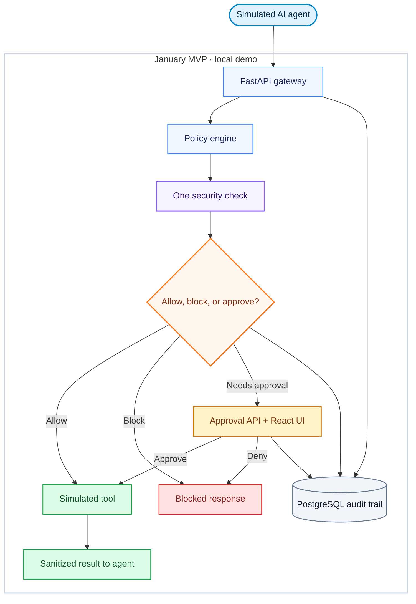
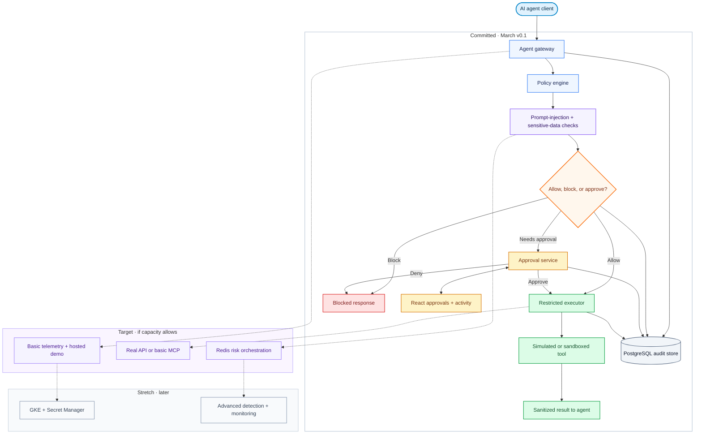

# AgentGuard

 

  

  <h3 align="center">AgentGuard</h3>

  

    An open-source runtime authorization and security gateway for AI agent tool calls.
     
     
    <a href="https://github.com/DSC-McMaster-U/agent-guard">View Repository</a>
    ·
    <a href="https://github.com/DSC-McMaster-U/agent-guard/issues/new?template=bug.yml">Report Bug</a>
    ·
    <a href="https://github.com/DSC-McMaster-U/agent-guard/issues/new?template=feature.yml">Request Feature</a>
  

<!-- ABOUT THE PROJECT -->
## About The Project

AgentGuard is an open-source security gateway for AI agents that interact with external tools such as email services, databases, file systems, APIs, code execution environments, and Model Context Protocol servers.

AgentGuard is designed to intercept every proposed tool call before execution. It will evaluate actions using authorization policies, argument validation, prompt-injection detection, sensitive-data analysis, and optional human approval.

The committed versions focus on allowing, blocking, or pausing an action for approval. Restriction, rewriting, sandboxing, and rate limiting are possible later extensions.

The project will also include an open security benchmark for measuring attack success rates, benign task completion, false-positive rates, and false-negative rates.

### Planned Technology Stack

React, FastAPI, Python, PostgreSQL, Docker, and GitHub Actions support the committed release. Redis and OpenTelemetry are target enhancements. Google Cloud, GKE, Prometheus, and Grafana are stretch options.

* [![React][React.js]][React-url]
* [![FastAPI][FastAPI]][FastAPI-url]
* [![Python][Python]][Python-url]
* [![Redis][Redis]][Redis-url]
* [![PostgreSQL][PostgreSQL]][PostgreSQL-url]
* [![Docker][Docker]][Docker-url]
* [![GKE][GKE]][GKE-url]
* [![GoogleCloud][GoogleCloud]][GoogleCloud-url]
* [![GitHubActions][GitHubActions]][GitHubActions-url]
* [![OpenTelemetry][OpenTelemetry]][OpenTelemetry-url]
* [![Prometheus][Prometheus]][Prometheus-url]
* [![Grafana][Grafana]][Grafana-url]

### January MVP Architecture

The team targets one reliable end-to-end security decision flow by late January for a local MVP demo. An external showcase may take place in January, but its date has not been confirmed.

The internal MVP includes one initial prompt-injection or sensitive-data detector. Redis workers, production credentials, expanded MCP support, advanced observability, and cloud hardening are later goals.

### March v0.1 Architecture

The March release plan separates requirements from optional enhancements. The end-of-year showcase is expected, but its date has not been confirmed. Solid connections show the committed `v0.1` flow. Dashed connections show target and stretch work that must not delay the release.

The [original full-cloud architecture diagram](images/architecture.png) is preserved as a reference for possible future expansion.

The committed release includes:

* An Agent Gateway for intercepting and validating tool calls
* A Policy Engine for deterministic authorization
* Prompt-injection and sensitive-data checks with structured findings
* A Decision Engine for allowing, blocking, or pausing actions for approval
* A Human Approval Service for high-risk actions
* A React approval, activity, and basic trace dashboard
* A Restricted Tool Executor for one simulated or sandboxed tool
* PostgreSQL for policies, events, decisions, approvals, and audit logs
* Docker Compose, CI, tests, documentation, and twenty to thirty benchmark scenarios

Capacity-dependent target enhancements include Redis workers, a Risk Orchestrator, one real API or basic MCP integration, basic telemetry, and a hosted demonstration.

Production GKE hardening, Google Secret Manager, complete monitoring dashboards, and advanced security workers remain stretch goals.

## Contributors

| Name | Role | GitHub | Notable Contributions |
| --- | --- | --- | --- |
| Sana Ashraf | AI/ML & Security | TBD | TBD |
| Nozhin Azarpanah | Backend | TBD | TBD |
| Erfan Zamani | AI/ML & Security | TBD | TBD |
| Naman Sonawane | Full Stack | TBD | TBD |
| Barzin Vazifedoost | Full Stack | TBD | TBD |
| Sheraz Arshad | Backend | TBD | TBD |
| Pranoy Mukherjee | AI/ML & Security | TBD | TBD |
| MD Mahib | Full Stack | TBD | TBD |
| Billy Wu | Backend | [Billy423](https://github.com/Billy423) | TBD |
| Trisha Raj | DevOps & Infrastructure | TBD | TBD |
| Nelavan Karunanithi | DevOps & Infrastructure | TBD | TBD |

<!-- MARKDOWN LINKS -->
[React.js]: https://img.shields.io/badge/React-20232A?style=for-the-badge&logo=react&logoColor=61DAFB
[React-url]: https://react.dev/

[FastAPI]: https://img.shields.io/badge/FastAPI-009688?style=for-the-badge&logo=fastapi&logoColor=white
[FastAPI-url]: https://fastapi.tiangolo.com/

[Python]: https://img.shields.io/badge/Python-3776AB?style=for-the-badge&logo=python&logoColor=white
[Python-url]: https://www.python.org/

[Redis]: https://img.shields.io/badge/Redis-DC382D?style=for-the-badge&logo=redis&logoColor=white
[Redis-url]: https://redis.io/

[PostgreSQL]: https://img.shields.io/badge/PostgreSQL-336791?style=for-the-badge&logo=postgresql&logoColor=white
[PostgreSQL-url]: https://www.postgresql.org/

[Docker]: https://img.shields.io/badge/Docker-2496ED?style=for-the-badge&logo=docker&logoColor=white
[Docker-url]: https://www.docker.com/

[GKE]: https://img.shields.io/badge/GKE-4285F4?style=for-the-badge&logo=googlecloud&logoColor=white
[GKE-url]: https://cloud.google.com/kubernetes-engine

[GoogleCloud]: https://img.shields.io/badge/Google_Cloud-4285F4?style=for-the-badge&logo=googlecloud&logoColor=white
[GoogleCloud-url]: https://cloud.google.com/

[GitHubActions]: https://img.shields.io/badge/GitHub_Actions-2088FF?style=for-the-badge&logo=githubactions&logoColor=white
[GitHubActions-url]: https://github.com/features/actions

[OpenTelemetry]: https://img.shields.io/badge/OpenTelemetry-000000?style=for-the-badge&logo=opentelemetry&logoColor=white
[OpenTelemetry-url]: https://opentelemetry.io/

[Prometheus]: https://img.shields.io/badge/Prometheus-E6522C?style=for-the-badge&logo=prometheus&logoColor=white
[Prometheus-url]: https://prometheus.io/

[Grafana]: https://img.shields.io/badge/Grafana-F46800?style=for-the-badge&logo=grafana&logoColor=white
[Grafana-url]: https://grafana.com/
