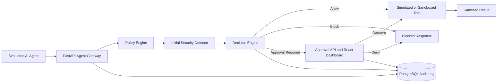
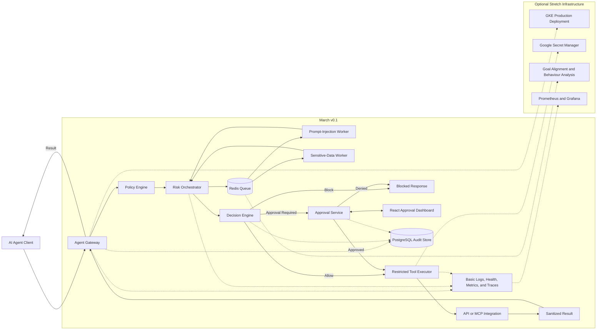

# AgentGuard

 

  

  <h3 align="center">AgentGuard</h3>

  

    An open-source runtime authorization and security gateway for AI agent tool calls.
     
     
    <a href="https://github.com/DSC-McMaster-U/agent-guard">View Repository</a>
    ·
    <a href="https://github.com/DSC-McMaster-U/agent-guard/issues/new?template=bug.yml">Report Bug</a>
    ·
    <a href="https://github.com/DSC-McMaster-U/agent-guard/issues/new?template=feature.yml">Request Feature</a>
  

<!-- ABOUT THE PROJECT -->
## About The Project

AgentGuard is an open-source security gateway for AI agents that interact with external tools such as email services, databases, file systems, APIs, code execution environments, and Model Context Protocol servers.

AgentGuard is designed to intercept every proposed tool call before execution. It will evaluate actions using authorization policies, argument validation, prompt-injection detection, sensitive-data analysis, and optional human approval.

Based on the evaluation, AgentGuard may allow, block, restrict, rewrite, sandbox, rate-limit, or pause an action for approval.

The project will also include an open security benchmark for measuring attack success rates, benign task completion, false-positive rates, and false-negative rates.

### Planned Technology Stack

* [![React][React.js]][React-url]
* [![FastAPI][FastAPI]][FastAPI-url]
* [![Python][Python]][Python-url]
* [![Redis][Redis]][Redis-url]
* [![PostgreSQL][PostgreSQL]][PostgreSQL-url]
* [![Docker][Docker]][Docker-url]
* [![GKE][GKE]][GKE-url]
* [![GoogleCloud][GoogleCloud]][GoogleCloud-url]
* [![GitHubActions][GitHubActions]][GitHubActions-url]
* [![OpenTelemetry][OpenTelemetry]][OpenTelemetry-url]
* [![Prometheus][Prometheus]][Prometheus-url]
* [![Grafana][Grafana]][Grafana-url]

### Fall Showcase MVP Architecture

The November showcase focuses on one reliable end-to-end security decision flow that can run locally with Docker Compose.

The showcase includes one initial prompt-injection or sensitive-data detector. Redis workers, production credentials, expanded MCP support, advanced observability, and cloud hardening are later goals.

### Target Architecture

The March `v0.1` target expands the showcase flow with asynchronous security analysis, restricted execution, one or two integrations, and essential operational visibility. Dashed connections identify optional stretch infrastructure.

The [original full-cloud architecture diagram](images/architecture.png) is preserved as a reference for possible future expansion.

The target architecture includes:

* An Agent Gateway for intercepting and validating tool calls
* A Policy Engine for deterministic authorization
* A Risk Orchestrator for coordinating security analysis
* Security workers for prompt-injection and sensitive-data analysis
* A Decision Engine for allowing, blocking, or pausing actions for approval
* A Human Approval Service for high-risk actions
* A Restricted Tool Executor for securely calling one or two supported tools
* Redis for asynchronous security-analysis jobs
* PostgreSQL for policies, events, decisions, approvals, and audit logs
* Basic logs, service health, metrics, and OpenTelemetry traces
* A repeatable deployment for one demonstration environment

Production GKE hardening, Google Secret Manager, complete monitoring dashboards, and advanced security workers remain stretch goals.

## Contributors

| Contributor | Most Used Frameworks/Tools | Notable Contributions |
| --- | --- | --- |
| **TBD**   <i>Frontend</i> | TBD | TBD |
| **TBD**   <i>Frontend</i> | TBD | TBD |
| **TBD**   <i>Backend</i> | TBD | TBD |
| **TBD**   <i>Backend</i> | TBD | TBD |
| **TBD**   <i>Backend</i> | TBD | TBD |
| **TBD**   <i>AI/ML & Security</i> | TBD | TBD |
| **TBD**   <i>AI/ML & Security</i> | TBD | TBD |
| **TBD**   <i>AI/ML & Security</i> | TBD | TBD |
| **TBD**   <i>DevOps & Infrastructure</i> | TBD | TBD |
| **TBD**   <i>DevOps & Infrastructure</i> | TBD | TBD |
| **TBD**   <i>Full-Stack / Open to Anything</i> | TBD | TBD |
| **TBD**   <i>Full-Stack / Open to Anything</i> | TBD | TBD |

<!-- MARKDOWN LINKS -->
[React.js]: https://img.shields.io/badge/React-20232A?style=for-the-badge&logo=react&logoColor=61DAFB
[React-url]: https://react.dev/

[FastAPI]: https://img.shields.io/badge/FastAPI-009688?style=for-the-badge&logo=fastapi&logoColor=white
[FastAPI-url]: https://fastapi.tiangolo.com/

[Python]: https://img.shields.io/badge/Python-3776AB?style=for-the-badge&logo=python&logoColor=white
[Python-url]: https://www.python.org/

[Redis]: https://img.shields.io/badge/Redis-DC382D?style=for-the-badge&logo=redis&logoColor=white
[Redis-url]: https://redis.io/

[PostgreSQL]: https://img.shields.io/badge/PostgreSQL-336791?style=for-the-badge&logo=postgresql&logoColor=white
[PostgreSQL-url]: https://www.postgresql.org/

[Docker]: https://img.shields.io/badge/Docker-2496ED?style=for-the-badge&logo=docker&logoColor=white
[Docker-url]: https://www.docker.com/

[GKE]: https://img.shields.io/badge/GKE-4285F4?style=for-the-badge&logo=googlecloud&logoColor=white
[GKE-url]: https://cloud.google.com/kubernetes-engine

[GoogleCloud]: https://img.shields.io/badge/Google_Cloud-4285F4?style=for-the-badge&logo=googlecloud&logoColor=white
[GoogleCloud-url]: https://cloud.google.com/

[GitHubActions]: https://img.shields.io/badge/GitHub_Actions-2088FF?style=for-the-badge&logo=githubactions&logoColor=white
[GitHubActions-url]: https://github.com/features/actions

[OpenTelemetry]: https://img.shields.io/badge/OpenTelemetry-000000?style=for-the-badge&logo=opentelemetry&logoColor=white
[OpenTelemetry-url]: https://opentelemetry.io/

[Prometheus]: https://img.shields.io/badge/Prometheus-E6522C?style=for-the-badge&logo=prometheus&logoColor=white
[Prometheus-url]: https://prometheus.io/

[Grafana]: https://img.shields.io/badge/Grafana-F46800?style=for-the-badge&logo=grafana&logoColor=white
[Grafana-url]: https://grafana.com/
